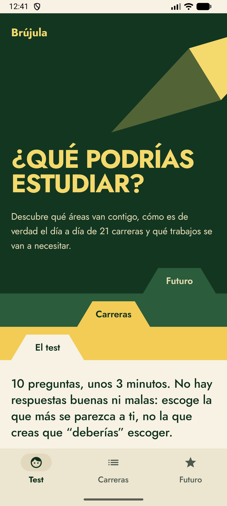
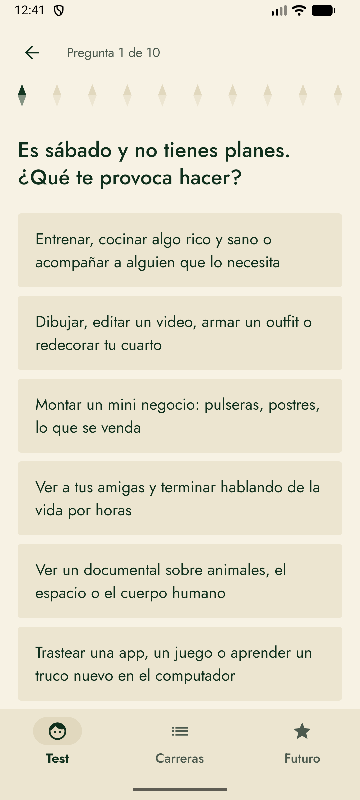
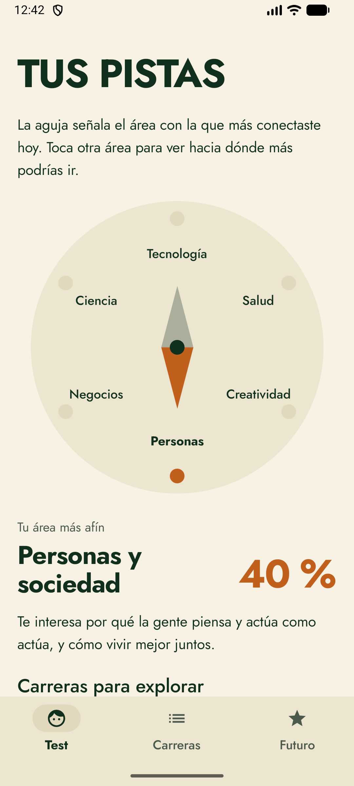
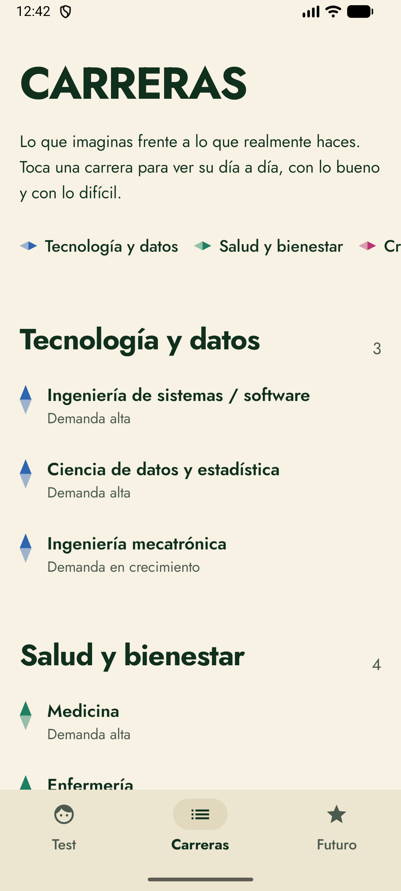
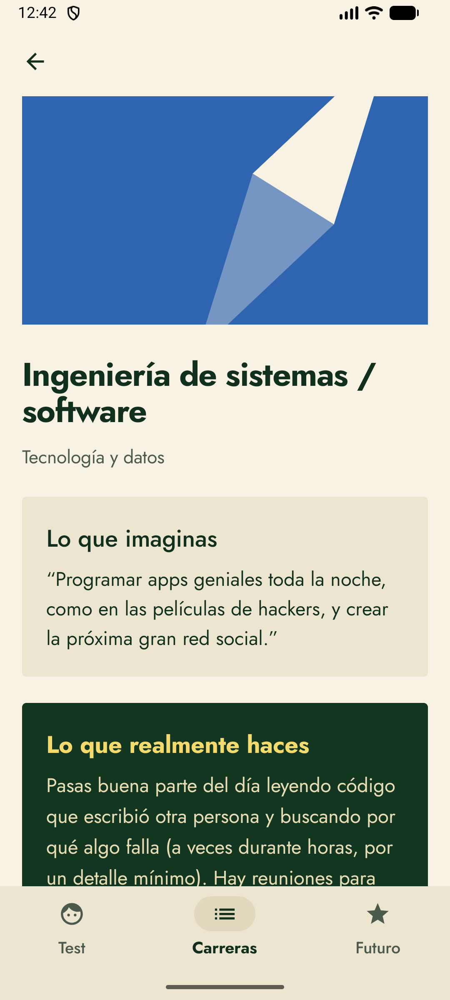
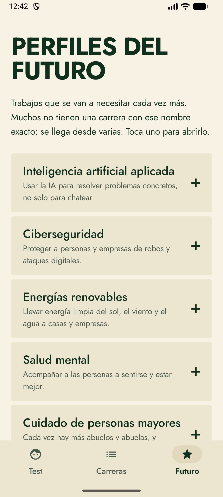
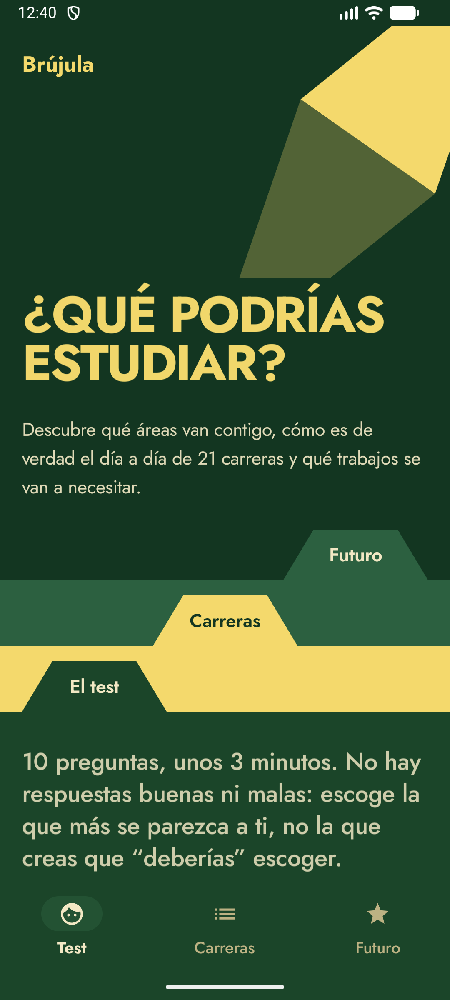

# Brújula — Orientación vocacional para adolescentes (Android)

Aplicación Android sin conexión que ayuda a adolescentes a descubrir qué áreas les atraen y a explorar carreras y trabajos del futuro, con información honesta sobre lo que cada carrera implica en la práctica.

## Problema que resuelve
A los 15 años se elige carrera con poca información: lo que se imagina de una profesión suele ser muy distinto de su día a día real. Brújula propone un test corto y sin respuestas «correctas», muestra las áreas afines como una pista (no como un veredicto) y contrasta para cada carrera «lo que imaginas» con «lo que realmente haces».

## Tecnologías
- **Kotlin** y **Jetpack Compose** con **Material 3**
- Diseño propio: paleta verde botella y dorado, motivo de aguja de brújula y tipografía Jost (licencia OFL)
- Funciona 100 % sin internet: sin permisos de red, sin cuentas y sin recolección de datos
- SharedPreferences para guardar el último resultado

## Funcionalidades principales
- **Test** de 10 preguntas (unos 3 minutos) sobre 6 áreas: Tecnología, Salud, Ciencia, Creatividad, Negocios y Personas.
- **Resultado** en una brújula interactiva: la aguja apunta al área más afín y se puede tocar otra área para verla.
- **21 carreras** con lo que se imagina, lo que realmente se hace, la demanda y hacia dónde va el futuro.
- **10 perfiles del futuro** (por ejemplo, IA aplicada, ciberseguridad, energías renovables): qué se hace, lo difícil, habilidades y caminos para llegar.
- Sugerencia de preguntarle a alguien que ya trabaje en el área.
- Modo claro y oscuro.

## Capturas de pantalla
| Inicio | Pregunta | Resultado | Carreras |
|---|---|---|---|
|  |  |  |  |

| Detalle de carrera | Perfiles del futuro | Modo oscuro |
|---|---|---|
|  |  |  |

## Instalación y uso
**Requisitos:** Android Studio (o JDK 21 + Gradle 9.3), Android SDK 37, Android 8.0 (API 26) o superior.

1. Clona el repositorio:
   ```bash
   git clone https://github.com/ricardoprs76-max/brujula.git
   ```
2. Compila e instala:
   ```bash
   ./build.sh          # release firmada con la clave de depuración
   ./build.sh debug
   ```
   o abre la carpeta en Android Studio y pulsa *Run*. No necesita Firebase ni claves.
3. En la app, pulsa **Empezar el test** y responde las 10 preguntas. Las pestañas **Carreras** y **Futuro** se pueden explorar en cualquier momento.

## Contacto
**Ricardo Augusto Porras Díaz** — Desarrollador de software y abogado especialista en derecho administrativo
- Correo: [ricardoprs76@gmail.com](mailto:ricardoprs76@gmail.com)
- GitHub: [github.com/ricardoprs76-max](https://github.com/ricardoprs76-max)
